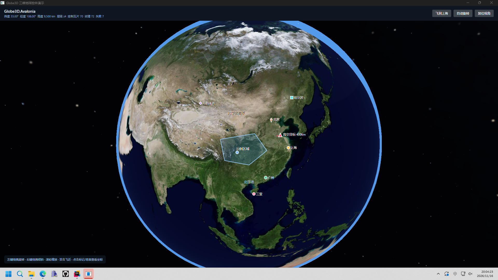

# Globe3D.Avalonia

[](https://www.nuget.org/packages/Globe3D.Avalonia)
[](https://www.nuget.org/packages/Globe3D.Avalonia)
[](LICENSE)
[](https://dotnet.microsoft.com/)
[](https://avaloniaui.net/)

面向 Avalonia 12 的实时三维地球控件。基于 OpenGL ES 3.0 渲染影像瓦片、程序化星空与大气辉光，
并在其上叠加三维标记点（支持 png/jpg/gif/svg 图标）、区域多边形与文字标注，
内置瓦片分层 LOD 与完整的鼠标交互。



## 目录

- [特性](#特性)
- [环境与兼容性](#环境与兼容性)
- [安装](#安装)
- [快速开始](#快速开始)
  - [最简用法](#最简用法)
  - [添加标记、区域与标注](#添加标记区域与标注)
  - [图片图标标记](#图片图标标记)
  - [相机控制](#相机控制)
  - [事件与命中查询](#事件与命中查询)
  - [性能面板](#性能面板)
- [数据源](#数据源)
- [交互](#交互)
- [主要属性](#主要属性)
- [技术说明](#技术说明)
- [已知限制](#已知限制)
- [示例工程](#示例工程)
- [Native AOT 与裁剪](#native-aot-与裁剪)
- [打包与发布](#打包与发布)
- [版本记录](#版本记录)
- [许可](#许可)

## 特性

| 能力 | 说明 |
| --- | --- |
| 影像瓦片 | Web 墨卡托 XYZ 金字塔，网格直接由墨卡托参数映射到球面，无接缝 |
| 分层 LOD | 四叉树按瓦片距离 + 掠射角 + 屏幕投影尺寸选择层级，同一帧内近景/地平线用高层级、远处用低层级 |
| 数据源 | MBTiles（离线 SQLite）、HTTP（在线 + 磁盘缓存）、内置天地图/星图地球工厂、多源组合 |
| 稀疏回退 | 某层级瓦片缺失时自动沿祖先链回退，区域外不会出现黑洞 |
| 星空 | 程序化生成（三层哈希星点 + 银河带），随相机旋转，零图片资源 |
| 大气 | 菲涅尔边缘散射 + 外发光环，颜色与强度可调 |
| 三维标记 | 经纬度 + 海拔，自动处理球体遮挡，可绘制高度引线 |
| 图片图标 | png / jpg / gif / bmp / webp / svg 直接作为图标，可单独设置缩放与像素偏移 |
| 接近提示 | 鼠标靠近标记点时高亮并在鼠标旁弹出提示，可按标记点关闭 |
| 区域 | 经纬度顶点自动做球面细分，支持填充与描边 |
| 文字标注 | 使用 Avalonia 矢量绘制，中文清晰，自动防重叠避让 |
| 交互 | 左键旋转、右键倾斜、滚轮缩放、双击飞行、标记/地表拾取 |
| 渲染调度 | 按需渲染，静止时 CPU/GPU 占用归零 |
| 性能面板 | 一键开启的性能 HUD：0-100 流畅度评分、帧率/刷新率/帧耗时、瓦片与加载队列、MBTiles/磁盘缓存与网络的实时读取速度 |

## 环境与兼容性

| 项目 | 说明 |
| --- | --- |
| 目标框架 | `net8.0` |
| 依赖 | Avalonia 12.1.6、Silk.NET.OpenGLES 2.22.0、Microsoft.Data.Sqlite 8.0.11 |
| 渲染后端 | OpenGL ES 3.0（`OpenGlControlBase`）。Windows 由 ANGLE 提供（底层 D3D11），无需额外运行时 |
| 平台 | Windows / Linux 桌面；Linux 与国产化平台需要系统加载器提供 GLES 3.0 驱动 |
| 线程模型 | 控件与叠加层绘制在 UI 线程，瓦片下载/解码在后台线程；图标解码可跨线程调用 |
| Native AOT | 库开启 AOT/裁剪分析（`IsAotCompatible`，零告警）；示例以 Native AOT 发布并验证通过，见 [Native AOT 与裁剪](#native-aot-与裁剪) |

## 安装

```bash
dotnet add package Globe3D.Avalonia
```

或直接在工程中引用：

```xml
<PackageReference Include="Globe3D.Avalonia" Version="1.1.0" />
```

XAML 命名空间：

```xml
<Window xmlns:g="clr-namespace:Globe3D.Avalonia;assembly=Globe3D.Avalonia">
```

## 快速开始

### 最简用法

```xml
<g:GlobeView MbTilesPath="D:\maps\satellite.mbtiles" />
```

### 添加标记、区域与标注

```csharp
// 普通标记
var cityLayer = new GlobeLayer("城市");
cityLayer.Markers.Add(new GlobeMarker
{
    Position = new GeoPoint(39.9042, 116.4074),   // 纬度, 经度
    Label = "北京",
    Shape = MarkerShape.Pin,
    Fill = Brushes.OrangeRed
});

// 三维标记点：经度、纬度、高度（米）
cityLayer.Markers.Add(new GlobeMarker
{
    Position = new GeoPoint(35d, 118d, 400_000d),
    Label = "高空目标 400km",
    Shape = MarkerShape.Triangle,
    ShowAltitudeLine = true
});
globe.Layers.Add(cityLayer);

// 区域多边形
var region = new GlobeRegion
{
    Label = "示例区域",
    Fill = new SolidColorBrush(Color.Parse("#3348A0FF")),
    Stroke = Brushes.SkyBlue,
    StrokeThickness = 2
};
region.AddPoint(28, 100).AddPoint(34, 98).AddPoint(36, 110).AddPoint(31, 114);

var regionLayer = new GlobeLayer("区域");
regionLayer.Regions.Add(region);
globe.Layers.Add(regionLayer);

// 纯文字标注
var labelLayer = new GlobeLayer("标注");
labelLayer.Labels.Add(new GlobeLabel
{
    Position = new GeoPoint(42d, 103d),
    Text = "内蒙古高原",
    Foreground = Brushes.Khaki
});
globe.Layers.Add(labelLayer);
```

### 图片图标标记

任何 Avalonia `IImage` 都能当作标记图标；也可以只给文件路径，控件会按需加载并缓存。
支持 png / jpg / jpeg / gif（取首帧）/ bmp / webp，以及 **svg**（内置矢量渲染，缩放不模糊）。

```csharp
var layer = new GlobeLayer("图片标记");

// 1) 直接给文件，缩放 0.5、向上偏移 26px（图钉尖端对准坐标点）
layer.Markers.Add(new GlobeMarker
{
    Position = new GeoPoint(39.9042, 116.4074),
    ImagePath = @"Assets\pin.png",
    ImageScale = 0.5,
    ImageOffset = new Vector(0, -26),
    HoverTip = "北京 · 机场"        // 可选：鼠标靠近时显示的内容
});

// 2) SVG 图标（矢量，任意缩放清晰）
layer.Markers.Add(new GlobeMarker
{
    Position = new GeoPoint(31.2304, 121.4737),
    ImagePath = @"Assets\radar.svg",
    ImageScale = 1.3,
    Tag = "上海雷达"
});

// 3) 自己解码好的 IImage（Bitmap / RenderTargetBitmap / 任意第三方 IImage）
layer.Markers.Add(new GlobeMarker
{
    Position = new GeoPoint(23.1291, 113.2644),
    Image = new Bitmap(@"Assets\target.jpg"),
    ImageScale = 0.46
});

globe.Layers.Add(layer);

// 也可以手动加载（同一文件被多个标记点复用时只会解码一次，缓存最多 64 个图标）
IImage icon = MarkerImage.Load(@"Assets\dot.gif");
IImage svg = MarkerImage.FromSvg("<svg viewBox='0 0 24 24'>...</svg>");
```

| 标记点属性 | 说明 |
| --- | --- |
| `Image` / `ImagePath` | 图标来源，同时设置时以 `Image` 为准；加载失败时 `ImageError` 给出原因，并回退到底色图形 |
| `ImageScale` | 相对图像自身像素尺寸的缩放倍数，默认 1 |
| `ImageOffset` | 相对锚点的像素偏移（正值向右/向下），常用来把图钉尖端对准坐标 |
| `ShowHoverTip` | 是否参与接近提示，默认 true；设为 false 后靠近时既不高亮也不弹提示 |
| `HoverTip` | 接近时显示的内容，为空时依次回退到 `Label`、`ToolTip` |
| `HoverRadius` | 该标记点单独的接近判定半径（像素），不大于 0 时用控件的 `MarkerHoverRadius` |

### 相机控制

```csharp
globe.JumpTo(31.23, 121.47, 1_200_000);            // 立即定位
globe.FlyTo(31.23, 121.47, 260_000,
    TimeSpan.FromMilliseconds(1200));               // 平滑飞行

globe.CenterLatitude = 33;                          // 也可直接设属性
globe.CenterLongitude = 108;
globe.Altitude = 9_500_000;                         // 离地高度（米）
globe.Pitch = 25;                                   // 俯仰 0-88 度
```

### 事件与命中查询

```csharp
globe.GlobeClicked += (_, e) =>
{
    if (e.Location is { } p)
        Console.WriteLine($"纬度 {p.Latitude}, 经度 {p.Longitude}");
};

// 鼠标移动：携带屏幕坐标、地表经纬度、最近的标记点及其像素距离
globe.GlobePointerMoved += (_, e) =>
{
    if (e.NearestMarker is { } nearest && e.NearestDistance <= globe.MarkerHoverRadius)
        ShowPopupNearMouse(e.ScreenPosition, nearest.Tag);
};

// 接近状态变化（进入/离开标记点，离开时 Marker 为 null）
globe.MarkerHoverChanged += (_, e) => Console.WriteLine(e.Marker?.Tag ?? "离开标记点");

// 点击最近标记点：单击时按“离图标最近”命中，容忍点偏几个像素
globe.MarkerClicked += (_, e) => Console.WriteLine(e.Marker.Label);

// 主动查询：屏幕最近 / 经纬度最近
globe.FindNearestMarker(new Point(x, y), out var pixels);   // 不限距离，返回最近标记与距离
globe.FindNearestMarker(new Point(x, y), maxDistance: 24); // 限定命中范围
globe.FindNearestMarker(31.23, 121.47);                    // 按地表大圆距离

// 由外部输入转发或自动化测试驱动接近提示
globe.UpdateHoverMarker(new Point(x, y));
globe.UpdateHoverMarker(null);                              // 收起

globe.RenderingError += (_, message) => Console.WriteLine(message);
```

> 命中测试每次都用**当前相机**重新投影并做地平线遮挡剔除，球体背面的标记点不会被误判为可悬停/可点击，
> 也不依赖上一帧的屏幕坐标缓存。

### 性能面板

```csharp
globe.ShowPerformancePanel = true;   // 左上角显示评分 / 帧率 / 瓦片与 IO 速度

var stats = globe.GetPerformanceSnapshot();   // 也可以自己取数打日志或画 HUD
Console.WriteLine($"{stats.FramesPerSecond:0.0} fps, score {stats.SmoothnessScore}, " +
                  $"{stats.DiskReadBytesPerSecond:0} B/s");
```

面板包含 0-100 流畅度评分（帧耗时 45% + 抖动 20% + 达成帧率 35%，以 60 FPS 为满分线；
绿色 ≥90、黄色 ≥70、红色 <70）、帧率、刷新率、帧耗时、绘制瓦片/纹理数、LOD 层级与选瓦片耗时、
加载队列，以及 MBTiles / 磁盘缓存 / 网络的瓦片读取速度与单瓦片耗时。空闲超过 1 秒后帧耗时/刷新率
显示 `—`（不再回放旧样本），评分保留最近一次测量值。
详细指标含义、采样方式与局限见 [docs/performance-panel.md](docs/performance-panel.md)（英文）。

## 数据源

### MBTiles（离线）

```csharp
globe.MbTilesPath = @"D:\DMap\mapabc\data\satellite.mbtiles";
```

要求：标准 MBTiles，`tiles` 表为 TMS 行序（自南向北），`tile_data` 为 PNG/JPEG。
若数据实际使用 XYZ 行序，可显式构造：

```csharp
globe.TileSource = new MbTilesTileSource(path, flipY: false);
```

### 在线瓦片（天地图 / 星图地球）

控件不内置任何地图凭证，key/token 由调用方传入。内置工厂负责拼接 URL、筛选图片类型并走磁盘缓存：

```csharp
// 星图地球卫星影像（默认请求 JPEG，任何平台都能直接解码）
globe.TileSource = OnlineTileSources.CreateGeovisEarth(
    token: "你的 token",
    cacheDirectory: @"C:\TileCache\geovis");

// 天地图卫星影像（WMTS，JPEG/PNG）
globe.TileSource = OnlineTileSources.CreateTiandituSatellite(
    token: "你的 tk",
    cacheDirectory: @"C:\TileCache\tianditu");
```

通用 URL 模板（支持 `{z}`、`{x}`、`{y}`、`{-y}` 占位符）：

```csharp
globe.TileSource = new HttpTileSource(
    "https://example.com/{z}/{x}/{y}.png",
    cacheDirectory: @"C:\TileCache");
```

> 跨平台提示：星图地球默认使用 `format=jpeg`，避免个别平台缺少 WebP 解码能力时出现空白瓦片；
> 需要 WebP 时可传 `preferWebP: true`。天地图返回 JPEG/PNG，桌面与移动平台均可直接使用。

### 多源组合（本地优先，在线兜底）

```csharp
globe.TileSource = new CompositeTileSource(
    new MbTilesTileSource(@"D:\maps\china.mbtiles"),
    new HttpTileSource("https://example.com/{z}/{x}/{y}.png", @"C:\TileCache"));
```

## 交互

| 操作 | 行为 |
| --- | --- |
| 左键拖拽 | 旋转地球；松手瞬间仍在移动时带惯性，拖到位置停稳后再松手不滑动 |
| 右键拖拽 | 倾斜与航向 |
| 滚轮 | 缩放 |
| 双击 | 飞行到点击位置 |
| 单击 | 拾取最近的标记点，或返回地表经纬度 |
| 鼠标悬停 | 靠近开启提示的标记点时高亮并在鼠标旁显示内容 |

## 主要属性

| 属性 | 类型 | 默认值 | 说明 |
| --- | --- | --- | --- |
| `CenterLatitude` | double | 32 | 观察中心纬度 |
| `CenterLongitude` | double | 108 | 观察中心经度 |
| `Altitude` | double | 10 200 000 | 相机离地高度（米） |
| `Pitch` | double | 0 | 俯仰角，0-88 |
| `Heading` | double | 0 | 航向角 |
| `MinAltitude` / `MaxAltitude` | double | 10 000 / 51 000 000 | 缩放上下限 |
| `MbTilesPath` | string? | null | MBTiles 路径，自动创建数据源 |
| `TileSource` | ITileSource? | null | 自定义瓦片源 |
| `ShowStars` / `StarIntensity` | bool / double | true / 1.0 | 星空开关与亮度 |
| `AtmosphereColor` / `AtmosphereIntensity` | Color / double | #5AA8FF / 0.85 | 大气颜色与强度 |
| `LightingIntensity` | double | 0.28 | 地表方向光明暗 |
| `ShowLabels` | bool | true | 文字标注开关 |
| `MarkerHoverRadius` | double | 18 | 鼠标接近标记点的默认判定半径（像素） |
| `MarkerHitTolerance` | double | 6 | 单击命中标记点的额外容忍距离（像素） |
| `AutoRotate` / `AutoRotateSpeed` | bool / double | false / 6 | 自动旋转 |
| `ShowPerformancePanel` | bool | false | 显示性能面板（帧率、刷新率、瓦片与 IO 统计） |
| `Layers` | AvaloniaList&lt;GlobeLayer&gt; | 空 | 图层集合，XAML 默认内容 |

## 技术说明

- 渲染后端：`Avalonia.OpenGL.Controls.OpenGlControlBase` + `Silk.NET.OpenGLES`
- Windows 下由 ANGLE 提供 OpenGL ES 3.0（底层走 D3D11），无需额外运行时
- 瓦片网格用 `vec2` 参数化（9×9 顶点），顶点着色器完成墨卡托 → 球面映射，
  所有瓦片共享同一 VAO，每个瓦片只需更新 4 个 uniform
- 分层 LOD：以数据源最低层级为根做四叉树遍历，每个瓦片按「相机距离 + 掠射角」估计
  所需层级，再叠加「投影尺寸超过一个纹理边长」的屏幕空间误差；单帧叶子数超预算时
  把同层同父兄弟合并回父瓦片（不要求四片齐全，只降精度、不留空洞）。`GetDrawnZoomRange()` /
  `GetDrawnLevelHistogram()` 可查看当前帧的层级分布
- 瓦片加载：请求带优先级与「最近需要帧号」，相机移开后残留请求会被丢弃；失败瓦片在
  冷却期过后自动重试；祖先纹理只作兜底显示，不会阻止更细瓦片的请求
- 纹理上传：GLES 3.0 核心不支持 `GL_BGRA`，解码后统一转换为 RGBA 通道顺序
- 区域填充：顶点在三维球面上按大圆展开，填充前先裁剪到相机可见半球，
  跨 ±180° 经线与越过地平线的区域都能正确闭合，屏幕空间再做近平面与视口裁剪
- 极区：墨卡托纬度截断在 ±85.05°，最北/最南一行把到极点的空隙摊到整行几何上，
  正对极点俯视时不会露出没有几何的圆盘状空洞
- 文字与图标由 Avalonia 矢量绘制叠加在 GL 表面之上，中文渲染质量高且可避让
- 图片图标按路径懒加载并缓存（有容量上限的 LRU，默认 64；文件时间/大小变化后自动重读）；
  SVG 由内置的 `SvgMarkerImage` 解析成 Avalonia `Geometry` 后**每帧矢量绘制**，
  缩放时不需要重新栅格化，也不引入 Skia/Svg 等额外依赖，便于国产化平台部署
- 命中测试用「当前相机」重新投影 + 地平线遮挡剔除，再按图标实际尺寸算包围盒：
  鼠标接近按「到包围盒的距离」判定，单击按「最近的一个」命中，层级靠后的标记点优先
- 惯性：`PointerReleased` 时若指针已静止超过 120 ms，则视为停稳松手，不触发惯性滑动
- 性能统计：帧耗时按最近 120 帧环形缓冲统计；空闲超过 1 秒后帧耗时/刷新率归零（面板显示 `—`），
  评分以固定 60 FPS 为满分线，避免用帧间隔估算的刷新率做分母造成循环归一化；瓦片 IO 由
  `MbTilesTileSource` / `HttpTileSource` 用 `Interlocked` 计数（逻辑读取量）；面板每 500 ms 采样一次，
  关闭时不创建定时器也不绘制；`GetPerformanceSnapshot()` 可在不显示面板时自行取数
- 依赖：Avalonia 12.1.6、Silk.NET.OpenGLES 2.22.0、Microsoft.Data.Sqlite 8.0.11

## 已知限制

- 区域跨越 ±180° 经线时按「最短路径」解释边：若起点到终点的经度差超过 180°，
  实际连的是另一侧；需要绘制超宽区域时请在 ±180° 处拆分顶点
- 主流瓦片服务在 ±85° 以上没有影像，极冠由最边一行的纹理拉伸填充，放大后会看出拉伸痕迹
- 需要可用的 OpenGL ES 3.0 环境，暂未提供软件渲染回退
- GIF 只取首帧，不做动画播放
- 内置 SVG 渲染支持 `svg / g / rect / circle / ellipse / line / polyline / polygon / path`
  与 `fill / stroke / stroke-width / opacity / transform`，渐变只取首个色标近似；
  滤镜、文本、外部引用等特性请自行解码为 `IImage` 后赋给 `Image`
- 图标缓存最多保留 64 个文件（`MarkerImage.MaxCachedImages`），已移除的标记点若仍引用
  图标对象，内存由该引用本身决定，缓存淘汰不会让它们失效

## 示例工程

`samples/Globe3D.Demo` 展示影像瓦片、城市标记、图片图标、三维高空标记、区域与文字标注的完整用法：

### 配置自己的地图密钥

示例工程**不包含任何地图服务密钥**，在线底图需要你使用自己的 key：

1. 复制 `samples/Globe3D.Demo/keys.sample.json` 为同目录下的 `keys.local.json`
2. 填入自己的天地图 `tk` / 星图地球 `token`（支持数组，多个 key 会在启动时随机轮换）
3. 该文件已被 `.gitignore` 忽略，不会提交到仓库；也可用环境变量 `GLOBE3D_KEYS_FILE` 指向其它位置的配置文件

```json
{
  "tianditu": [ "你的天地图 tk" ],
  "geovis": [ "你的星图地球 token" ]
}
```

未配置密钥时示例仍可运行（本地 MBTiles 与内置图层），但不会注册在线底图；请勿把填有密钥的
`keys.local.json` 提交到仓库或随程序分发。

```
dotnet run --project samples/Globe3D.Demo                              # 默认（有本地 MBTiles 时优先用本地）
dotnet run --project samples/Globe3D.Demo -- --basemap=geovis         # 星图地球在线影像（需配置密钥）
dotnet run --project samples/Globe3D.Demo -- --basemap=tianditu       # 天地图在线影像（需配置密钥）
dotnet run --project samples/Globe3D.Demo -- --hover-test             # 图片标记 + 接近提示 + 鼠标旁浮层
dotnet run --project samples/Globe3D.Demo -- --hit-test               # 背面标记的命中回归（应查不到）
dotnet run --project samples/Globe3D.Demo -- --horizon-test           # 倾斜视角查看分层 LOD
dotnet run --project samples/Globe3D.Demo -- --seam-test              # 查看跨 180° 经线区域
dotnet run --project samples/Globe3D.Demo -- --seam-close             # 贴地斜视时跨 180° 区域的半球裁剪
dotnet run --project samples/Globe3D.Demo -- --deep-test              # 88 km 贴地视角
dotnet run --project samples/Globe3D.Demo -- --street-test            # 3 km 街区级视角（深层级瓦片）
dotnet run --project samples/Globe3D.Demo -- --pole-test              # 正对极点的极区填充
dotnet run --project samples/Globe3D.Demo -- --stats-test             # 输出一次 [PERF] 性能快照到 demo.log
```

界面右上角的「底图」按钮可在本地 MBTiles、星图地球与天地图之间轮换；「性能面板」按钮控制
左上角性能 HUD 的开关。状态栏会显示当前帧的层级范围、绘制瓦片数、纹理数与失败数，demo.log 中
还会记录各层级的瓦片分布、图标解码结果与命中回归结果。

## Native AOT 与裁剪

控件不使用反射、`dynamic`、运行时 XAML 解析或序列化框架，库已开启 `IsAotCompatible`
（AOT/裁剪分析器零告警，IL2026/IL2067/IL3050 已提升为编译错误），可直接被 Native AOT 应用引用。

示例工程已启用 `PublishAot`，一条命令即可发布自包含原生程序：

```bash
dotnet publish samples/Globe3D.Demo -c Release -r win-x64
```

产物位于 `samples/Globe3D.Demo/bin/Release/net8.0/win-x64/publish/`，其中：

- `Globe3D.Demo.exe`：原生可执行文件（约 33 MB，运行时不依赖 .NET）
- `av_libglesv2.dll`：ANGLE（OpenGL ES 转 D3D11）
- `e_sqlite3.dll`：MBTiles（SQLite）原生库
- `libSkiaSharp.dll`、`libHarfBuzzSharp.dll`：文字与位图渲染

Windows 上 Native AOT 需要 MSVC C++ 工具链（Visual Studio「使用 C++ 的桌面开发」工作负载）。
已在 AOT 产物上验证：四叉树 LOD 与深缩放、街区/极点/跨经线视角、MBTiles 与在线瓦片及磁盘缓存、
PNG/JPG/GIF/SVG 图标、区域与标注、标记悬停与命中回归、性能面板统计，均与 JIT 版本一致。

> 若本地存在 `samples/Globe3D.Demo/keys.local.json`，它会随发布复制到输出目录；分发示例程序前
> 请将其删除或移至 `%LocalAppData%\Globe3D\keys.local.json`，避免泄露你的地图密钥。

使用注意：

- 自定义 XAML 请保持编译绑定（`AvaloniaUseCompiledBindingsByDefault=true`），
  `{Binding}` 改为 `{CompiledBinding}`，避免依赖裁剪后的反射入口
- 不要在运行时用 `XamlReader` 加载未编译的 XAML 资源
- 应用自身若使用反射/动态代码，仍需按常规 AOT 方式标注；控件本身无需额外配置

详细说明（英文）见 [docs/native-aot.md](docs/native-aot.md)。

## 打包与发布

```bash
# 生成 nupkg 与 snupkg（输出到 src/Globe3D.Avalonia/bin/Release）
dotnet pack src/Globe3D.Avalonia/Globe3D.Avalonia.csproj -c Release

# 发布到 nuget.org（需要先配置 API Key）
dotnet nuget push src/Globe3D.Avalonia/bin/Release/Globe3D.Avalonia.1.1.0.nupkg \
    --api-key $NUGET_API_KEY --source https://api.nuget.org/v3/index.json
```

仓库地址已在 `Globe3D.Avalonia.csproj` 的 `RepositoryUrl` / `PackageProjectUrl` 中配置，
发布前请按 [语义化版本](https://semver.org/lang/zh-CN/) 更新 `Version` 与 [CHANGELOG.md](CHANGELOG.md)。

## 版本记录

见 [CHANGELOG.md](CHANGELOG.md)。

## 许可

[MIT](LICENSE) © 2026 daipeng0809
