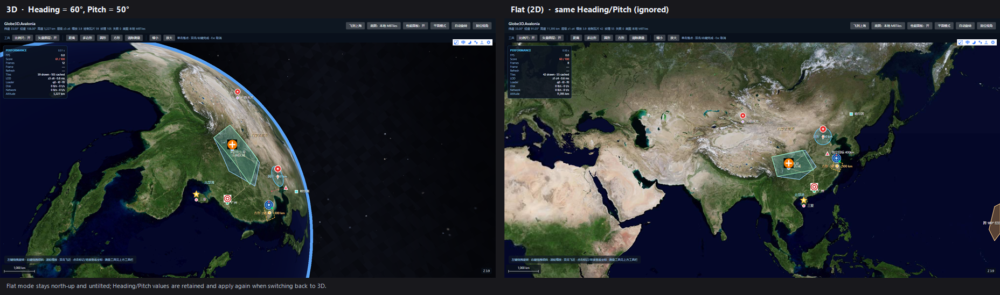

# Flat (2D) Mode

`GlobeView` can switch between the default 3D globe and a flat 2D Web Mercator map at runtime.
The same tile pyramid, LOD selection, layers, markers, regions, labels, hover and hit testing are
reused in both modes; the projection, rendering pass and input mapping change.

## Enabling

XAML:

```xml
<g:GlobeView IsFlatMode="True" />
```

Code:

```csharp
globe.IsFlatMode = true;    // 2D Web Mercator plane, keeps the current zoom level
globe.IsFlatMode = false;   // back to the 3D globe, keeps the current zoom level

globe.SetFlatMode(true);                          // same as above
globe.SetFlatMode(true, preserveZoomLevel: false); // keep Altitude instead of the level
```

`IsFlatMode` defaults to `false`. The switch is a normal `StyledProperty`, so it can be bound,
animated in code, or toggled from a toolbar button. Assigning the property (and the default
`SetFlatMode` call) preserves the **displayed zoom level**: the level is read in the old projection
and the camera altitude is recomputed in the new one. If the level cannot be measured because the
control is not laid out yet, the projection is switched with the current altitude. If the level is
measurable but the GL surface has not measured its physical pixel size yet, the level is stored and
applied after the first rendered frame. Switching cancels any running flight/inertia animation and
applies the new projection at the current centre.

Pass `preserveZoomLevel: false` to restore the old behaviour of keeping `Altitude` unchanged.
The sample exposes a **平面模式 / 三维模式** button and the `--flat`, `--flat-toggle-test`,
`--orientation-test` and `--view-api-test` command-line switches.

## Interaction

| Input | 3D mode | Flat mode |
| --- | --- | --- |
| Left drag | Rotate the globe (with inertia) | Pan the map (with inertia) |
| Right drag | Tilt and heading | Ignored |
| Mouse wheel | Zoom via `Altitude` | Zoom via `Altitude` |
| Double click | Fly to the clicked location | Fly to the clicked location and zoom in |
| Single click | Pick a marker or return the ground coordinate | Same |
| Hover | Marker highlight and tooltip | Same |

`Pitch` and `Heading` keep their values but are ignored while flat mode is active, so switching back
to 3D restores the previous orientation. Right-drag tilt is disabled in flat mode.

## Heading and pitch in flat mode

Flat mode is a north-up orthographic Web Mercator view. `Heading` (map rotation) and `Pitch`
(tilt) only affect the 3D globe: the flat projection does not rotate or tilt, even when both
properties are non-zero.

In 3D, `Pitch` is a **true view pitch**: the angle between the line of sight and the surface normal
at the centre point (0 = straight down, larger = closer to horizontal, clamped to 88). The camera
solves the orbital offset for the current altitude, so at low altitude a large pitch no longer puts
the centre point behind the globe; the offset converges towards the horizon. `GetEffectivePitch()`
returns the actual angle of the current camera (0 in flat mode).

The sample's `--orientation-test` sets `Heading = 60°` and `Pitch = 50°` in flat mode and then
switches back to 3D. The screenshot below illustrates the contrast with those values configured:

- **Left — 3D**: the globe is rotated and tilted by the values.
- **Right — flat (2D)**: the map remains north-up and untilted.

The values themselves are retained, so switching back to 3D applies them again; they are not reset
when flat mode is entered. If you need a rotating or tilted 2D map, it is not provided by this
projection and would require a separate implementation.



## What changes in flat mode

- The globe sphere, star field, atmosphere glow and surface lighting are not rendered; the tile
  imagery is drawn as a flat Web Mercator plane on the control background.
- `Altitude` is reused as the zoom control. `MinAltitude` / `MaxAltitude` still define the zoom range.
- Marker altitude is ignored: markers are placed at their geographic position, and altitude leader
  lines are hidden. `GlobeLabel` and region labels are projected in the same way.
- The map is bounded: it does not wrap horizontally. Panning stops at ±180° and at the Web Mercator
  latitude limit (±85.05°); beyond the data the control shows the fallback tile color / background.
- A region that crosses the antimeridian is split into a left and a right part instead of being
  drawn as a band across the whole map.
- Marker hover, click, `FindNearestMarker` and `GlobePointerMoved` continue to work; screen hit
  testing uses the current flat camera and the marker's geographic position.

## API

```csharp
// Toggle the mode (preserves the zoom level by default)
globe.IsFlatMode = true;
globe.SetFlatMode(false, preserveZoomLevel: true);

// Atomic centre + level: one conversion against the final physical-pixel viewport
globe.SetView(31.23, 121.47, 12);              // same as JumpToLevel

// The underlying camera exposes the flat projection state and helpers
var camera = globe.Camera;
bool flat = camera.IsFlat;

camera.PanFlatByPixels(dx, dy, globe.Bounds.Width, globe.Bounds.Height);
if (camera.TryGetFlatViewportBounds(out var west, out var east, out var south, out var north))
{
    // visible geographic rectangle
}
```

In flat mode the viewport clamps the projection centre to keep the map filling the control. This
clamp does **not** write back `CenterLatitude` / `CenterLongitude`: the properties keep the centre
requested by the application, so zooming out and back in returns to it. The clamp result is only
written back by user interactions (drag, wheel zoom, auto rotation) via `PanFlatByPixels` /
`SetFlatCenter`.
`GlobeView.EffectiveCenterLatitude` / `EffectiveCenterLongitude` (also on `OrbitCamera`) report the
centre actually drawn, which may differ near the map edge; the sample status bar uses these values.

`GetPerformanceSnapshot()` and the performance HUD continue to work in flat mode; frame timing,
tile LOD, loader queue and tile I/O are measured in the same way. The altitude row still reports
the camera altitude, which now controls the flat zoom.

## Implementation notes

- The planar projection is driven by `OrbitCamera.IsFlat`. `FlatScaleFactor` expresses how many
  Mercator world pixels correspond to one viewport height; it is derived from altitude and field of
  view (not from latitude), and is shared by the GL surface and the Avalonia overlay so both use the
  same scale at any DPI. Because the scale is latitude-independent, panning north/south does not
  change zoom or tile LOD.
- Tiles are drawn with a dedicated vertex shader (`FlatVertex`) that maps each tile to a
  pre-computed NDC rectangle. The rectangle is calculated in double precision on the CPU, which
  keeps deep zoom levels stable where a single-precision world-pixel coordinate would lose
  precision.
- Tile LOD uses the same quadtree traversal as 3D mode. The desired zoom is
  `log2(worldPixels / 256)`, where `worldPixels = FlatScaleFactor * viewportHeight`.
- Tile samples, markers and labels that touch ±180° are projected directly from longitude/latitude
  (`ProjectGeo`). Going through a 3D unit vector would otherwise flip the endpoint to the other
  side of the map at deep zoom or at the antimeridian.
- Flat regions are unwrapped in geographic space and clipped to [-180, 180]; the clipping can
  produce one polygon per side of the map, and each part is filled and stroked separately.
- Switching between 3D and flat mode reuses `ZoomToLevel`'s conversion: the displayed level is kept
  rather than the raw altitude, because the 3D level includes `cos(centre latitude)` while the flat
  level does not. Extreme latitudes may hit `MinAltitude` / `MaxAltitude`, in which case the closest
  reachable level is used. Running flight/inertia animations are cancelled by the switch.
- Auto rotation and drag inertia are clamped to the flat map bounds, so the requested centre does not
  keep moving past ±180° and jump when the view is zoomed out later.

## Demo

```bash
dotnet run --project samples/Globe3D.Demo -- --flat
dotnet run --project samples/Globe3D.Demo -- --flat-toggle-test
dotnet run --project samples/Globe3D.Demo -- --orientation-test
dotnet run --project samples/Globe3D.Demo -- --view-api-test
```

`--flat` starts directly in 2D mode. `--flat-toggle-test` enables 2D, pans the map, switches back
to 3D and writes the results to `demo.log`. `--orientation-test` sets Heading/Pitch in flat mode,
logs that the flat view remains north-up, switches to 3D and logs the retained values.
`--view-api-test` checks level-preserving mode switches, atomic `SetView`, centre preservation while
zooming out/in in flat mode, and low/high-altitude pitch (`[VIEW]` lines).

## Compatibility and limitations

- Requires Avalonia **12.1.1** or newer (the package declares Avalonia 12.1.1 as its minimum).
- Works with the same Native AOT configuration as the 3D mode; no reflection or runtime XAML is
  involved. The win-x64 AOT build is verified with both modes.
- The flat map is intentionally non-wrapping and bounded to the Web Mercator extent; it is not a
  tiled infinite canvas.
- Flat mode is a rendering projection, not a change of the data source. Map tile licensing,
  attribution and local surveying/map-publication compliance remain the responsibility of the
  application and its tile provider.
