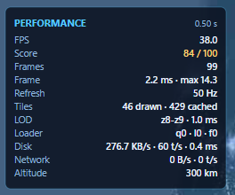

# Performance Panel

`GlobeView` ships with a built-in, opt-in performance HUD that reports a smoothness score, frame rate,
refresh rate, frame cost, tile pipeline state and real-time tile I/O throughput. It is drawn with
Avalonia vector primitives on top of the OpenGL surface, never receives pointer input, and costs
nothing while disabled.



## Enabling the panel

XAML:

```xml
<g:GlobeView ShowPerformancePanel="True" />
```

Code:

```csharp
globe.ShowPerformancePanel = true;

// ... and later
globe.ShowPerformancePanel = false;
```

The panel is anchored to the top-left corner of the control and refreshes every 500 ms.

## What the panel shows

| Row | Meaning | Unit |
| --- | --- | --- |
| `FPS` | Rendered frames per second over the last sampling window. `0.0` is normal while the globe is idle, because rendering is on demand. | frames/s |
| `Score` | Smoothness score from 0 to 100 (see [Smoothness score](#smoothness-score)). `—` until at least three frames were rendered inside one sampling window; the last measured score stays visible while idle. | 0-100 |
| `Frames` | Total frames rendered by the control since it was created. | count |
| `Frame` | Average and maximum CPU time of a single frame, measured over the last 120 rendered frames. Shows `—` while idle (more than 1 s without a frame), because the window no longer describes current timing. | ms |
| `Refresh` | Refresh rate estimated from the fast-frame quartile: the 25th-percentile frame interval of the same 120-frame window (`1000 / p25 interval`). Shows `—` when fewer than 8 intervals are available or while idle. A shortest-interval estimate is skewed by occasional back-to-back frames (several tiles becoming ready at once), while the modal interval can drop below the real capability when some frames miss the composition tick; the fast quartile is a stable middle ground and approximates the render/composition ceiling while the camera is moving. | Hz |
| `Tiles` | Tiles actually drawn in the last frame and textures currently held in the GPU texture cache. | count |
| `LOD` | Coarsest–finest zoom levels drawn in the last frame, followed by the time spent in the quadtree tile-selection pass. | zoom / ms |
| `Loader` | Loader pipeline state: `q` queued, `l` downloading or decoding, `f` failed and cooling down before retry. | count |
| `Disk` | Tile bytes read per second from MBTiles (SQLite) or from the `HttpTileSource` disk cache, tiles per second, and the average time of one tile read. | B/s, tiles/s, ms |
| `Network` | Tile bytes downloaded per second, tiles per second, and the average time of one download (including the HTTP request round trip). | B/s, tiles/s, ms |
| `Altitude` | Current camera altitude above the ground. | km |

The title bar shows the exact sampling window (e.g. `0.50 s`) used for all rate calculations.

### Reading the numbers

- **Idle view, `FPS 0.0`** — expected. `GlobeView` only renders when something changes
  (camera movement, new tile, layer edit). Move or zoom the globe to see live frame rates. After one
  second without new frames, `Frame` and `Refresh` switch to `—` instead of replaying the previous
  interaction's samples, while `Score` keeps the last measured value.
- **`Tiles` drawn equals `cached`** — the current view is fully served from the GPU texture cache;
  `Disk` and `Network` rows register no activity.
- **`Disk` busy while `Network` is quiet** — MBTiles or a warm HTTP disk cache is feeding the view.
  A high average read time (tens of ms per tile) points at a slow disk or a large `tiles` table
  without a covering index.
- **`Network` busy** — new tiles are being fetched. The average download time includes DNS,
  request latency and body transfer, so it is normally much larger than the disk read time.
- **`Loader` backlog (`q`)** — the loader intentionally keeps at most 1536 requests queued and
  drops requests the camera has moved away from; a large `q` that drains quickly is healthy.
- **`LOD` selection time** — CPU cost of the quadtree traversal. A spike usually comes from a
  steep pitch or a very low altitude where the tree is visited deeply.

## Sampling API

The same numbers are available without the panel, e.g. for logging or for a custom HUD:

```csharp
var stats = globe.GetPerformanceSnapshot();

Console.WriteLine(
    $"fps={stats.FramesPerSecond:0.0} frame={stats.FrameMilliseconds:0.00}ms " +
    $"refresh={stats.RefreshRateHz:0}Hz tiles={stats.DrawnTiles}/{stats.CachedTextures} " +
    $"lod=z{stats.MinZoom}-z{stats.MaxZoom} disk={stats.DiskReadBytesPerSecond:0}B/s " +
    $"net={stats.NetworkBytesPerSecond:0}B/s");
```

`GetPerformanceSnapshot()` returns a `GlobePerformanceSnapshot` value with the following fields:

| Field | Description |
| --- | --- |
| `FramesPerSecond` | Frames rendered per second over the sampling window. |
| `SmoothnessScore` | 0-100 smoothness score; `-1` until a sampling window rendered at least three frames. |
| `RenderedFrames` | Cumulative rendered frame count. |
| `FrameMilliseconds` / `MaxFrameMilliseconds` | Average / maximum CPU render time in the 120-frame window; `0` after more than one second without frames. |
| `RefreshRateHz` | Refresh rate estimated from the 25th-percentile frame interval; `0` when unavailable or idle. |
| `DrawnTiles` / `CachedTextures` / `FailedTiles` | Last-frame drawn tiles, cached textures, failed (cooling down) tiles. |
| `QueuedTiles` / `LoadingTiles` | Loader queue depth and active downloads/decodes. |
| `MinZoom` / `MaxZoom` | Zoom range drawn in the last frame; `-1` when nothing was drawn. |
| `SelectionMilliseconds` | Quadtree selection pass duration of the previous frame. |
| `DiskReadBytesPerSecond` / `DiskTilesPerSecond` / `DiskReadMilliseconds` | Disk tile throughput and average read time over the sampling window. |
| `DiskReadBytes` | Cumulative bytes read from MBTiles / disk cache. |
| `NetworkBytesPerSecond` / `NetworkTilesPerSecond` / `NetworkReadMilliseconds` | Network tile throughput and average download time over the sampling window. |
| `NetworkBytes` | Cumulative bytes downloaded. |
| `AltitudeMeters` | Camera altitude. |
| `SampleSeconds` | Time span covered by the rate fields. |

Rates are computed from the delta between **two consecutive calls**, so the very first call returns
`0` for every rate field. When the panel is visible it calls the same method twice per second; your
own calls simply share the same counters and each call measures its own interval.

### Smoothness score

`Score` is a 0-100 heuristic for how smooth the globe currently feels. It is recomputed on every
sampling tick (500 ms) that rendered **at least three frames**, and combines three normalized terms:

| Term | Weight | Formula | Meaning |
| --- | --- | --- | --- |
| Frame cost | 45% | `clamp(16.67 / averageFrameMs, 0, 1)` | How close the average CPU frame cost is to a 60 FPS budget. |
| Stability | 20% | `clamp(1 - (maxFrameMs - averageFrameMs) / 66.68, 0, 1)` | Penalizes slow outliers (stutter) even when the average is good. |
| Cadence | 35% | `clamp(fps / 60, 0, 1)` | Share of the 60 FPS target actually achieved in the sampling window. |

`score = round(100 × (0.45 × frameCost + 0.20 × stability + 0.35 × cadence))`, clamped to 0-100.
The panel colors the value green (≥ 90), amber (≥ 70) and red (below 70).

The target is a fixed 60 FPS on purpose: normalizing cadence by the *estimated* refresh rate would
be circular, because that estimate is derived from the same frame intervals — a steady 30 FPS would
look like a perfect fit. The score therefore measures absolute smoothness against 60 FPS and is
comparable across machines. It describes CPU frame cost, jitter and achieved cadence, not GPU load
or visual quality; a GPU-bound scene can still score high.

While the globe is idle the score is not recomputed, so the last measured value stays visible; `—`
means no sampling window has yet rendered enough frames (for example when the panel is switched on
while the view is static).

## How it is measured

- **Frame statistics** — `GlobeSurface` records the wall-clock duration of every successfully
  rendered frame plus the interval since the previous frame into a 120-entry ring buffer. Access is
  guarded by a small lock because frames are produced on the render thread and read on the UI thread.
  Once no frame has arrived for more than one second, `GetRenderStats()` reports the frame cost and
  refresh estimate as `0` (shown as `—`) instead of replaying the previous interaction's samples.
- **Tile I/O** — `MbTilesTileSource` and `HttpTileSource` report successful reads to an internal
  `TileIoMeter` using `Interlocked` counters (bytes, read count, elapsed stopwatch ticks). The
  meter is incremented on loader worker threads.
- **Panel** — a `DispatcherTimer` at `DispatcherPriority.Background` samples the snapshot twice
  per second, replaces an immutable row array and calls `InvalidateVisual()`. The timer is created
  only while `ShowPerformancePanel` is `true` and stops when the control leaves the visual tree.

### Overhead

- Panel disabled: one dormant `Control` child, no timer, no counters beyond a few interlocked adds
  per loaded tile.
- Panel enabled: two snapshot reads and ~20 short strings per second, plus one small vector draw.
- Frame timing uses `Stopwatch.GetTimestamp()`; it measures the CPU cost of issuing the frame, not
  GPU execution time.

## Limitations

- Byte counts are **logical reads** of the storage layer (SQLite page reads / `File.ReadAllBytes`
  / HTTP response bodies). They are not physical disk throughput, and reads served from the OS
  page cache count as disk reads.
- The MBTiles read time covers the `SELECT` round trip, not opening the pooled connection.
- The refresh-rate estimate is a heuristic derived from frame intervals; it reports the render
  ceiling observed while frames are produced, not a query to the monitor's EDID.
- Frame time is CPU-side only. A heavy scene that primarily loads the GPU may show small frame
  times and still feel slow; compare with `FPS` and the GPU driver's own tools.
- The smoothness score is a relative diagnostic, not a benchmark: it is derived from CPU frame cost,
  jitter and achieved FPS against a fixed 60 FPS target, and does not measure GPU load or visual
  quality.

## Demo

`samples/Globe3D.Demo` enables the panel by default and exposes a `性能面板` button in the toolbar
that toggles `ShowPerformancePanel`. For an automated smoke check:

```
dotnet run --project samples/Globe3D.Demo -- --stats-test --auto-close 8
```

After roughly five seconds the demo writes one `[PERF] ...` line with the snapshot values (including
`score=`) to `demo.log`, which is useful for comparing builds or machines.
